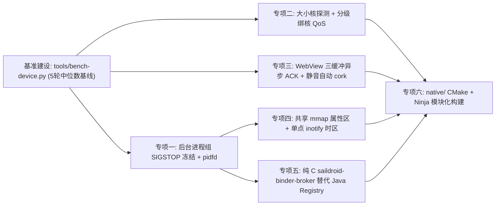
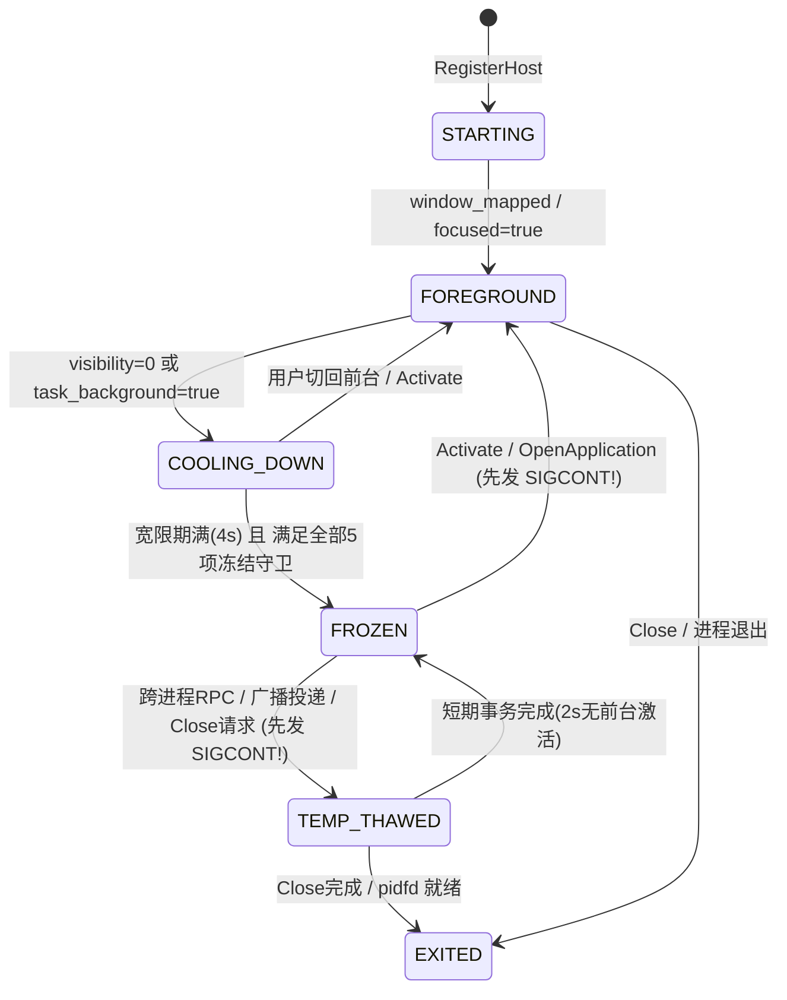

# SailDroid 进阶优化手册与本地推进计划（参照 `svbox-Android` 工程实践）

本文档将 [`nknkol/svbox-Android`](https://github.com/nknkol/svbox-Android) 中经过真机验证的底层设计与避坑经验，转化为适配 SailDroid（独立 ART + `bionic_translation` + 原生 Wayland 窗口宿主）的 **6 大专项技术手册** 与 **3 个 Sprint 本地落地执行计划**，供在本地工程（如 `/Users/zerox/WorkSpace/saildroid`）按阶段推进实施。

---

## 一、总体参照原则与演进矩阵

### 1.1 核心取舍原则

1. **坚守单应用轻量进程路线**：不引入整机 Android 容器（`zygote` + `system_server` + `SurfaceFlinger` ~3.5 GB RSS）或 `svc #0` 系统调用重写层，继续保持 SailDroid 按需启动单应用、原生融入 Sailfish OS Lipstick 多任务卡片的架构优势。
2. **吸收纯 C/C++ 原生系统基础设施**：重点借鉴 `svbox-Android` 在**进程组 `SIGSTOP` 冻结、大小核拓扑自适应调度、异步三缓冲解耦 ACK + 静音自动挂起、二进制共享属性区、纯 C 轻量 Binder 守护进程、以及 CMake 模块化构建与 5 轮中位数基准测试**上的成熟设计。
3. **严格遵守许可证与干净室（Clean-Room）边界**：`svbox-Android` 仓库根目录当前未附带顶层 `LICENSE` 文件（源码头多为 `MIT`）。推进时应**参照其协议语义、状态机设计与避坑清单在 SailDroid 内独立编写实现**；若需直接引入任何第三方代码片段，须先确认授权并在 [`THIRD-PARTY.md`](../THIRD-PARTY.md) 完整登记。

### 1.2 六大优化专项总览

| 专项 | 阶段 | 核心改造内容 | SailDroid 主要涉及文件 | 预期量化收益 | 难度 / 风险 |
|---|---|---|---|---|---|
| **专项一** | **P1.5** | 后台应用进程组 `SIGSTOP`/`SIGCONT` 零功耗冻结 + `pidfd` 退出监听 | [`native/host/host-manager.cpp`](../native/host/host-manager.cpp)、[`scripts/device/SdPower.java`](../scripts/device/SdPower.java)、[`scripts/device/SdRemoteServices.java`](../scripts/device/SdRemoteServices.java) | 退后台应用 CPU 降至 **0%**，消除 `host-manager` 250ms 轮询与 `/proc` 全盘扫描 | 中（需严密处理 Binder/锁死豁免） |
| **专项二** | **P1.5** | big.LITTLE 大小核拓扑自动探测 + 四档 CPU 亲和性 / `SCHED_BATCH` 治理 | [`native/host/host-bootstrap.c`](../native/host/host-bootstrap.c)、[`native/host/host-entry.cpp`](../native/host/host-entry.cpp)、`native/host/sched-policy.hpp`（新增） | 杜绝后台 `:service`/`dex2oat` 抢占大核，提升前台滑屏帧率稳定性 | 低 |
| **专项三** | **P1.5** | WebView 三缓冲无锁翻转（异步即刻 ACK + 后台停帧）+ 音频 600ms 静音自动 `cork` | [`native/webview/qt-helper/sdwebviewd.cpp`](../native/webview/qt-helper/sdwebviewd.cpp)、[`scripts/device/SdWebEngine.java`](../scripts/device/SdWebEngine.java)、[`native/rtp/PulseAudioGroup.cpp`](../native/rtp/PulseAudioGroup.cpp) | 解除 `sdwebviewd` 与 Android UI 线程锁步阻塞，消除空闲音频流声卡耗电 | 低~中 |
| **专项四** | **P2** | 只读 `mmap` 共享属性区 + 宿主单点 `inotify` 时区监听（废除每进程 5s 线程） | [`native/compat/runtime-hardware-properties.c`](../native/compat/runtime-hardware-properties.c)、[`scripts/device/SdTimeZone.java`](../scripts/device/SdTimeZone.java)、`native/host/host-propd.cpp`（新增） | 省去每进程启动 `dlopen` 导入开销，消灭所有应用进程的 5s 时区轮询线程 | 中 |
| **专项五** | **P2** | 纯 C 原生 `saildroid-binder-broker` 替代完整 ART 进程 [`SdBinderRegistry`](../scripts/device/SdBinderRegistry.java) | [`scripts/device/SdBinderRegistry.java`](../scripts/device/SdBinderRegistry.java)、[`scripts/device/SdSensorService.java`](../scripts/device/SdSensorService.java)、`native/binder/binder-broker.c`（新增） | Broker 内存从 **数十 MB 降至 < 2 MB**、启动从百毫秒级降至 **< 5 ms**，广播路由 `O(1)` | 中~高 |
| **专项六** | **P3** | `native/` CMake + Ninja 增量构建改造 + Sailfish 真机 5 轮中位数基准工具 | [`scripts/runtime/build-product.py`](../scripts/runtime/build-product.py)、[`tools/run-tests.py`](../tools/run-tests.py)、`native/CMakeLists.txt`、`tools/bench-device.py`（新增） | 原生代码修改秒级增量重编，每次优化产出可复现中位数对比报告 | 低~中 |

### 1.3 推进依赖关系图



---

## 二、分项技术设计与实现手册

### 专项一：后台应用进程组 `SIGSTOP`/`SIGCONT` 零功耗冻结与 `pidfd` 生命周期治理

#### 1. 现状痛点定位
- [`native/host/host-manager.cpp`](../native/host/host-manager.cpp) 第 515 行使用 `g_timeout_add(250, monitor, nullptr)` 每秒唤醒 4 次遍历 `entries`，并在 `reap_helpers()` 中全量遍历 `/proc` 查找同进程组残留子进程。
- 应用退至后台（Lipstick 最小化卡片，`visibility == 0` 或 `task_background == true`）后，进程内的 ART 并发 GC、网络长连接心跳、三方统计 SDK 定时器依旧持续唤醒 CPU。

#### 2. 核心架构与状态机设计



#### 3. 实施要点与五大防死锁铁律（必读）

> [!CAUTION]
> 被 `SIGSTOP` 冻结的进程无法响应 `SIGTERM`、无法处理 `window-*.sock` 控制命令，更无法回复同步 Binder 事务。漏掉任何一处前置 `SIGCONT` 都会导致调用方永久卡死！

1. **进程组原子信号封装（`host-manager.cpp`）**：
   - 每个 `Entry` 已记录 `process_group = pid`。冻结时在校验 `alive(record)` 与 `getpgid(pid) == pgid` 后调用 `kill(-pgid, SIGSTOP)`（连同该进程拉起的 `sdwebviewd` / `sdcamera-helper` 辅助子进程一并冻结，后台 0% CPU）；解冻时调用 `kill(-pgid, SIGCONT)`。
2. **五大不可冻结豁免守卫（Freeze Guards）**：
   - **守卫 1（封面快照未落盘）**：切后台后必须留 **4 秒冷却期（`COOLING_DOWN`）**，确保 Android 完成 `Activity.onStop()` 且 HWUI 完成 [`Java_SdWindowHost_nativeCoverFrame`](../native/window/sdwindow.c) 缩略图提交，避免 Lipstick 多任务卡片黑屏。
   - **守卫 2（持有活跃 `WakeLock`）**：在 [`SdPower.java`](../scripts/device/SdPower.java) 的 `acquire()` / `release()` 中，当 `wakeLocks.isEmpty()` 状态翻转时，通知 `HostManager1` 更新 `record["wake_lock_held"] = true/false`；持锁期间禁止冻结。
   - **守卫 3（活跃音频播放/录音/VoIP 通话）**：存在活跃音频流或 SIP 通话时（`record["audio_active"] == true`）禁止冻结。
   - **守卫 4（启动重负载锁持有期）**：`entry.heavy == true`（正在执行冷启动或 AOT 加载）期间严禁冻结，否则全局 `heavy_queue` 死锁。
   - **守卫 5（前台服务 `:service`）**：`SdRemoteServices.start(..., foreground=true)` 拉起的后台服务标记 `foreground_service = true` 时豁免冻结。
3. **强制前置解冻钩子（Pre-Thaw Hooks）**：
   - `HostManager1` 处理 `Activate`、`ActivateApplication`、`Close`、`StartService`、`StartProviderProcess`、`StartReceiverProcess` 时：**第一步先对目标包名全部关联 `Entry` 执行 `thaw_family(package)`（`kill(-pgid, SIGCONT)`）**，然后再发 `control("activate"/"close")` 或返回。
   - `monitor()` / 退出清理路径发 `SIGTERM` 前：借鉴 `svbox-Android` `Stop()` 顺序，严格执行 **`SIGCONT` → `SIGTERM` → 超时后 `SIGKILL`**。
4. **`pidfd_open` 替代 250ms 定时轮询**：
   - 在 `RegisterHost` 时调用 `int pidfd = syscall(SYS_pidfd_open, pid, O_NONBLOCK)`（Linux 5.3+ 原生支持，无需 root），通过 `g_unix_fd_add(pidfd, G_IO_IN, on_process_exited, key_ptr)` 挂载到 `host-manager` 的 `GMainLoop`；仅当存在 `retiring` 待回收孤儿进程组时才临时开启 250ms 定时器，清空后立即关闭定时器。

---

### 专项二：big.LITTLE 大小核拓扑自动探测与四档 CPU / QoS 调度治理

#### 1. 现状痛点定位
- [`native/host/host-bootstrap.c`](../native/host/host-bootstrap.c) 仅重置 `oom_score_adj = 0` 并提升 `RLIMIT_NICE = 40` 后降权 `execv("saildroid-host")`，未区分异构 ARM64 SoC（如骁龙 7c / 778G / 865 等）的大小核集群。后台 Receiver 爆发或 `dex2oat` 编译易抢占前台渲染大核。

#### 2. 拓扑探测与缓存设计（参照 `svbox-Android` `sched_qos.cpp`）
新建头文件 `native/host/sched-policy.hpp`，在 `saildroid-host --session` 启动时探测一次并写入 `$XDG_RUNTIME_DIR/saildroid/cpu-topology.json`：
1. **优先读取内核 sysfs**：遍历 `/sys/devices/system/cpu/cpu<N>/cpu_capacity`（或 `cpufreq/cpuinfo_max_freq`）。
2. **沙箱/内核缺失回退探针**：若 sysfs 不可读，绑定单核运行 ~2ms（25 万次 xorshift64* 整数迭代）微基准测量单核吞吐率。
3. **三簇聚类**：若 `(max_cap - min_cap) / max_cap < 0.08` 视为同构全核；否则按容量阈值切分为 `little`（`< min + 0.35 * span`）、`mid`、`big`（`>= max * 0.88`）。

#### 3. 四档调度策略表

| 档位枚举 | 适用进程 / 线程 | CPU 亲和性 (`sched_setaffinity`) | 调度策略 & Nice | I/O 优先级 |
|---|---|---|---|---|
| `TIER_FOREGROUND_UI` | 前台 Activity 主线程、`run_window` Wayland 线程、HWUI RenderThread、可见 `sdwebviewd` | `mid ∪ big`（无 mid 则 `all`） | `SCHED_OTHER`, `nice -4` | 默认 |
| `TIER_AUDIO_RT` | `PulseDevice` 通话线程、录音采集线程 | `mid ∪ big` | `SCHED_OTHER`, `nice -8` | 默认 |
| `TIER_BACKGROUND` | 退后台冷却期应用、`:service` / `:receiver` / `:provider` 子进程、隐藏态 `sdwebviewd` | `little ∪ mid`（优先 `little`） | `SCHED_BATCH`, `nice +10` | Best-effort low |
| `TIER_AOT_IDLE` | 后台 APK `dex2oat` 编译子进程 | 严格仅 `little` 核 | `SCHED_IDLE`, `nice +19` | `IOPRIO_CLASS_IDLE` |

- **前后台动态切换**：`host-manager.cpp` 在收到 `WindowEvent("focus", 1)` / `Activate` 时对主进程设置 `TIER_FOREGROUND_UI`，收到 `WindowEvent("visibility", 0)` / `task-background=1` 时立即降级为 `TIER_BACKGROUND`（4s 后若无豁免则进入专项一的 `FROZEN`）。

---

### 专项三：WebView 异步三缓冲解耦 ACK + 后台停帧与音频 600ms 静音自动挂起

#### 1. WebView 三缓冲邮箱（Triple-Slot Mailbox）改造
- **现状分析**：P1a 已将 [`sdwebviewd.cpp`](../native/webview/qt-helper/sdwebviewd.cpp) 与 [`SdWebEngine.java`](../scripts/device/SdWebEngine.java) 改为 `2 * MAX_FRAME_BYTES` 共享内存（消除管道拷贝），但 `sdwebviewd` 在第 272 行置 `awaitingAck = true` 后停止后续帧输出，直到 Android UI 主线程跑完 `ui.post` → `bitmap.copyPixelsFromBuffer` 才发送 `frame_ack`。当 UI 线程繁忙时，WebView 帧率被锁步腰斩。
- **参照 `svbox-Android` (`surface_bridge.cpp`) 改造步骤**：
  1. 将 SHM 文件大小由 `2L * MAX_FRAME_BYTES` 扩为 **`3L * MAX_FRAME_BYTES`**（槽位 `0, 1, 2`），或采用头部 64B 控制块 + 3 帧槽位。
  2. **`SdWebEngine` 读取线程即刻回发 ACK**：读取线程收到 `{"event":"frame","slot":s,"seq":n}` 后，记录 `latestReadySlot = s; latestWidth = w; latestHeight = h; latestSeq = n;`，将之前未被 UI 消费的旧槽归还，**立即在读取线程发出 `frame_ack`（不等待 `ui.post`）**，仅当 `!uiSwapScheduled.getAndSet(true)` 时向 UI 线程投递一次合并绘制任务。
  3. **`sdwebviewd` 槽位轮转保护**：`sdwebviewd` 维护 `inUseByUiSlot`，每次从空闲槽中选择写入槽位，彻底解除 GPU 渲染与 Android UI 线程的串行锁步。
  4. **切后台自动停帧**：确认 `SdWebViewProvider` 在窗口 `onWindowVisibilityChanged( != VISIBLE )` 时向 `sdwebviewd` 发送 `{"op":"visibility","active":false}`，停止 `renderTimer` 与 `watchdog`。

#### 2. 音频流 600ms 静音检测自动 `pa_stream_cork`
- **参照 `svbox-Android` (`audio_bridge.cpp` `HasNonSilentSamples`)**：
  - 在音频输出/RTP 播放写入回调中，以 4 样本步长快速扫描 PCM16 缓冲区（`std::abs(sample[i]) > 8`）：
    - 若存在有效波形，更新 `lastActiveNs = monotonic_ns()`；若当前处于 `corked` 状态，立即调用 `pa_stream_cork(playback, 0, nullptr, nullptr)` 恢复播放。
    - 若连续 `monotonic_ns() - lastActiveNs > 600_000_000LL`（600ms 全静音）且未 `corked`，调用 `pa_stream_cork(playback, 1, nullptr, nullptr)` 挂起流，允许 Sailfish PulseAudio 将硬件声卡切入省电挂起态。

---

### 专项四：只读共享内存属性区与单点 `inotify` 时区监听

#### 1. 现状痛点定位
- [`SdTimeZone.java`](../scripts/device/SdTimeZone.java) 第 37–58 行在**每一个已启动的 Android 应用进程和子进程**中常驻运行 `Thread.sleep(5000)`，每 5 秒调用 JNI `refreshNative()` → `realpath("/etc/localtime")` + 打开读取 `/usr/share/zoneinfo/...` 校验 `"TZif"` 魔数。若有 4 个进程驻留，每分钟产生 48 次无效文件 I/O 唤醒。
- [`runtime-hardware-properties.c`](../native/compat/runtime-hardware-properties.c) 在每个进程启动时重复 `dlopen("/usr/lib64/libhybris-common.so.1")` 与解析 `/etc/hw-release`。

#### 2. 参照 `svbox-Android` (`svbox_propd.c`) 改造设计
1. **会话级只读共享属性快照（`host-manager` 内置，零额外守护进程）**：
   - 在 `saildroid-host --session` 启动阶段执行一次硬件属性（`hwservicemanager.ready`）、产品属性（`/etc/hw-release` / `ro.product.*`）与初始时区（`persist.sys.timezone`）探测，写入 `$XDG_RUNTIME_DIR/saildroid/host-props.bin`（权限 `0600`，固定结构头：`magic = 0x53445052 "SDPR"`、原子递增 `uint32_t serial`、固定槽位键值数组或紧凑 Bionic Trie）。
   - 应用进程启动时直接 `open` + `mmap(..., PROT_READ, MAP_SHARED)` 批量导入到 `bionic_translation` 属性表，耗时从毫秒级 `dlopen` 降至 **< 10 µs**。
2. **宿主单点 `inotify` 驱动跨进程时区同步**：
   - 在 `saildroid-host --session` 的 `GMainLoop` 中注册单个 `inotify` FD，监听 `/etc`（关注 `localtime` 的 `IN_ATTRIB | IN_CREATE | IN_MOVED_TO | IN_DELETE`）与 `/var/lib/timed` 变动。
   - 一旦宿主时区改变，`host-manager` 重新校验 TZif、原子更新 `host-props.bin` 的 `timezone` 与 `serial`，并通过 Session D-Bus 广播 `TimeZoneChanged(s newZoneId)`。
   - [`SdTimeZone.java`](../scripts/device/SdTimeZone.java) **彻底删除 `while (...) Thread.sleep(5000)` 轮询线程**，改为通过 `HostApi` 订阅 D-Bus 信号回调触发 `SdServices.notifyTimeZoneChanged(identifier)`，实现 **0 待机轮询 + 毫秒级响应**。

---

### 专项五：纯 C 原生 `saildroid-binder-broker` 替代完整 ART 进程 `SdBinderRegistry`

#### 1. 现状痛点定位
- [`SdBinderRegistry.java`](../scripts/device/SdBinderRegistry.java)（仅 42 行）+ [`SdSensorService.java`](../scripts/device/SdSensorService.java)（80 行）目前作为一个完整 Android ART 进程（`org.saildroid.binder`）运行：
  - 每次会话首个应用冷启动时，[`host-entry.cpp`](../native/host/host-entry.cpp) 第 87 行调用 `EnsureBroker` 必须等待完整 ART VM 初始化框架、启动 Looper 才能放行应用启动；
  - 常驻占用一整份无 Zygote 共享的 ART 堆与代码页（数十 MB PSS）；
  - [`SdRemoteServices.java`](../scripts/device/SdRemoteServices.java) 第 78 行每次广播调用 `listServices(15)` 拉取全量服务名并在客户端线性过滤前缀。

#### 2. 参照 `svbox-Android` (`svbox_cameraserver.c` / `svbox_netd.c` / `svbox_binderd.c`) 改造设计
新建 `native/binder/saildroid-binder-broker.c`（纯 C11，直接编译为 ~30 KB 原生二进制 `/home/art/api29-root/libexec/saildroid-binder-broker`）：

1. **直接操作私有内核 Binder 设备（`<linux/android/binder.h>` ABI v8）**：
   - 校验 `/home/art/runtime/binder/binder`（`S_ISCHR`、`uid == getuid()`、`mode == 0600`、`BINDER_VERSION == 8`），`mmap` 128 KiB 只读事务区，调用 `ioctl(fd, BINDER_SET_CONTEXT_MGR, 0)` 成为句柄 `0` 上下文管理器。
   - 单线程 `epoll` 循环处理 `BINDER_WRITE_READ`：
     - **节点 `0`（`android.os.IServiceManager`）**：
       - `GET_SERVICE_TRANSACTION (1)` / `CHECK_SERVICE_TRANSACTION (2)`：校验 `sender_euid == getuid()`，从内存哈希表 `O(1)` 返回已注册 `flat_binder_object` 句柄；
       - `ADD_SERVICE_TRANSACTION (3)`：校验前缀（`saidroid.process.*` / `saidroid.provider.*` / `saidroid.sip.*`），存储句柄并自动发出 `BC_ACQUIRE` + **`BC_REQUEST_DEATH_NOTIFICATION`**（客户端崩溃退出收到 `BR_DEAD_BINDER` 时自动摘除死节点并回发 `BC_DEAD_BINDER_DONE` + `BC_RELEASE`）；
       - `LIST_SERVICES_TRANSACTION (4)`：兼容索引返回协议；
       - **新增扩展事务 `LIST_BY_PREFIX_TRANSACTION`**：直接按 `"saidroid.process.<pkg>."` 前缀一次返回同包全部存活子进程 `IBinder` 数组，将 [`SdRemoteServices.broadcast()`](../scripts/device/SdRemoteServices.java) 从 `N+1` 次跨进程 Binder 往返压缩为 **1 次往返**！
     - **内置本地节点 `NODE_SENSOR_SERVER`（`android.gui.SensorServer`）**：
       - 复刻 [`SdSensorService.java`](../scripts/device/SdSensorService.java) 事务码 `1..6`：创建 `AF_UNIX SOCK_SEQPACKET` 非阻塞 `socketpair`，通过 `BINDER_TYPE_FD` 返回空传感器事件通道，对未知句柄返回 `-EINVAL (-22)`。
2. **启动耗时与内存对比预期**：
   - `EnsureBroker` 就绪耗时从 ART 冷启动级缩短至 **< 5 ms**；常驻 RSS 降至 **~1.5 MB**。

#### 3. 附：`svbox-Android` Binder 与底层进程管理避坑核对清单（Checklist）

若后续编写 `saildroid-binder-broker.c` 或未来面向无 `binderfs` Linux 内核扩展用户态 Binder 时，务必逐条核对以下 `svbox-Android` 实测踩出的致命陷阱：

- [ ] **陷阱 1（12 字节 packed 死亡通知命令码）**：64 位 Linux `uapi/linux/android/binder.h` 中 `struct binder_handle_cookie` 带 `__packed` 属性，大小为 **12 字节（`0x0c`）** 而非自然对齐的 16 字节！因此 `BC_REQUEST_DEATH_NOTIFICATION` 真实值为 `0x400c630e`、`BC_CLEAR_DEATH_NOTIFICATION` 为 `0x400c630f`。若按未加 `packed` 的自定义结构体计算命令码会导致 `linkToDeath` 100% 静默失效。
- [ ] **陷阱 2（`recv() == 0` EOF 不修改 `errno`）**：非阻塞 Socket 判断对端关闭时，必须先独立判断 `if (n == 0) { /* EOF */ }`，严禁写成 `if (n <= 0 && errno != EAGAIN)`——因为 `recv` 返回 `0` 时不会清零前一次系统调用遗留的 `errno = EAGAIN`，会导致进程退出事件被漏检！
- [ ] **陷阱 3（句柄槽位耗尽绝不可回退 `0`）**：句柄 `0` 固定代表 `IServiceManager`。任何句柄分配器必须支持动态扩容并在死亡/释放时回收槽位，异常分支必须返回明确错误，绝不可退回 `0`（否则业务接口事务会被错发给 `ServiceManager` 造成界面假死）。
- [ ] **陷阱 4（`TF_ONE_WAY` 单向事务按目标节点 FIFO 串行）**：发往同一 Binder 实体节点的异步 `oneway` 事务必须保证按投递顺序串行执行完毕（收到 `BC_FREE_BUFFER` 后再派发下一条），否则生命周期回调（如 `bindApplication` 与 `scheduleCreateService`）并发乱序会触发应用 NPE。
- [ ] **陷阱 5（子进程 `spawn`/`fork` 遍历 `/proc/self/fd` 关闭高号 FD）**：当宿主 `RLIMIT_NOFILE` 较高（如 32768）时，不可只循环关闭 `fd < 1024`，必须像 [`camera-host.cpp`](../native/media/droid-camera/camera-host.cpp#L94-L95) 那样遍历 `/proc/self/fd` 关闭或设置 `O_CLOEXEC`，防止泄漏高号 FD。

---

### 专项六：原生层 CMake + Ninja 模块化改造与真机 5 轮中位数基准体系

#### 1. `native/CMakeLists.txt` 统一增量构建
- 将目前重复散落在 [`scripts/runtime/build-product.py`](../scripts/runtime/build-product.py)（第 99–118 行）和 [`tools/run-tests.py`](../tools/run-tests.py)（`verify_native_builds`）中的 15 个 `gcc`/`g++` 编译命令统一收敛到顶层 `native/CMakeLists.txt` + `CMakePresets.json`：
  - 目标列表：`sdbridge`、`sdwindow`（含 `wayland-scanner` 自定义产物规则）、`sdhost29`、`sdmaliit`、`saildroid-app`、`saildroid-host`、`sdhostapi`、`sdvoip`、`sdcamera-helper`、`sdcamera-host`、`sdmediaplayer-host`、`sdwebview-host`、`sdwebviewd`（启用 `CMAKE_AUTOMOC ON`）。
  - 在 [`tools/macos-container-env.sh`](../tools/macos-container-env.sh) 的 `build-native` 中直接运行 `cmake -B build/cmake-aarch64 -G Ninja && ninja -C build/cmake-aarch64`，单文件修改重编耗时从 ~60s 降至 **< 1.5s**。

#### 2. 真机 5 轮中位数性能基准脚本 `tools/bench-device.py`
参照 `svbox-Android` `EXPERIENCE_LOG.md` 的量化工程纪律，新增 `tools/bench-device.py --host root@192.168.2.15 --rounds 5 --output build/bench/<tag>.json`，固定采集以下 5 项同口径指标（输出 `median [min..max]` 并支持 `--compare baseline.json candidate.json`）：
1. **`cold_ttff_ms`**：清空运行态与 `saildroid-host --session` 后，从点击应用启动到出现 `SDWINDOW_SESSION=drawn` 的端到端毫秒数；
2. **`broker_ready_ms`**：`EnsureBroker` 到 `SDBINDER=registry_ready` 耗时；
3. **`remote_proc_ms`**：拉起 `:service` / `:receiver` 子进程到 `SDSERVICE=remote_process_ready` 耗时；
4. **`bg_idle_ctx_switches_per_sec`**：应用切入后台静置 30 秒期间，进程组总 `voluntary_ctxt_switches + nonvoluntary_ctxt_switches` 每秒增量（专项一落地后目标为 **`0.0 / s`**）；
5. **`total_pss_kb`**：主进程 + Broker + 子进程 + `sdwebviewd` 的 `/proc/<pid>/smaps_rollup` `Pss` 总和。

---

## 三、本地工程分阶段推进计划（Execution Plan）

### 前置准备（在本地 Mac `/Users/zerox/WorkSpace/saildroid` 执行一次）

```sh
cd /Users/zerox/WorkSpace/saildroid
git fetch origin p0-roadmap-and-cleanup
git checkout -B p0-roadmap-and-cleanup FETCH_HEAD

# 1. 使用 macOS 原生 container CLI 构建 aarch64 Ubuntu 24.04 编译测试环境并拉取依赖
bash tools/macos-container-env.sh setup

# 2. 跑通 38 项容器内基线回归测试（确认本地容器环境 100% 正常）
bash tools/macos-container-env.sh test

# 3. 编译当前 P0+P1 基线产物用于真机建档
bash tools/macos-container-env.sh build-native build/out-baseline
```

> [!IMPORTANT]
> **真机安全回滚规约**：每次向 Sailfish OS 设备（`root@192.168.2.15`）推送测试产物前，切勿直接覆盖原 `/home/art/releases/<accepted>` 目录！请先在设备上复制出一份候选目录（如 `cp -a $(readlink -f /home/art/api29-root) /home/art/releases/api28-dev-cand`），仅覆盖候选目录中的变更 `.so`/`runtime.jar`/`saildroid-host`，重新赋予 `setcap cap_dac_override,cap_sys_resource=ep /home/art/releases/api28-dev-cand/libexec/saildroid-app`，再用 `ln -sfn` 原子切换 `/home/art/api29-root`。一旦异常可 1 秒无损切回。

---

### Sprint 1：功耗清零与前台丝滑度收官（预计 3～4 天，对应 P1.5）

| 步骤 | 任务项 | 本地验证门禁（`macos-container-env.sh test`） | 真机验收标准（`192.168.2.15`） |
|---|---|---|---|
| **S1.1** | 编写 `tools/bench-device.py`，采集当前 P0+P1 真机 5 轮中位数基线 `baseline-p1.json` | Python 语法检查通过 | 输出完整 JSON 基线（TTFF、后台每秒切换数、总 PSS） |
| **S1.2** | 落地 **专项二**（`sched-policy.hpp` 大小核探测 + 四档 CPU 亲和性 / `SCHED_BATCH` / `SCHED_IDLE`） | 新增单测验证同构/异构 CPU 掩码钳位与回退逻辑 | `/proc/<pid>/status` 中 `Cpus_allowed_list` 前台绑大中核、后台子进程绑小核 |
| **S1.3** | 落地 **专项一**（`host-manager.cpp` `pidfd_open` + 4s 冷却期 + 5 项豁免守卫 + `SIGSTOP`/`SIGCONT` 冻结及前置解冻钩子） | 在 [`test-manager.py`](../native/host/tests/test-manager.py) 新增测试用例：后台自动 `State: T (stopped)`、`Activate`/`Close` 自动唤醒、持 WakeLock 不冻结 | 最小化 QQ/测试应用 10s 后 `/proc/<pid>/stat` 状态变为 `T`，静置 30s CPU 占用 **0.0%**，点击卡片瞬间恢复无卡顿 |
| **S1.4** | 落地 **专项三**（WebView 3 槽 SHM 异步即刻 ACK + 音频 600ms 静音 `pa_stream_cork`） | 更新 [`test-webview-shm.py`](../scripts/runtime/tests/test-webview-shm.py) 覆盖 3 槽并发读写无撕裂与回退 | WebView 长页面快速滑动帧间隔 P95 明显下降；静音 1s 后 `pactl list sink-inputs` 显示 `Corked: yes` |

---

### Sprint 2：控制面与系统守护进程原生化（预计 5～7 天，对应 P2 第一阶段）

| 步骤 | 任务项 | 本地验证门禁 | 真机验收标准 |
|---|---|---|---|
| **S2.1** | 落地 **专项四**（`host-props.bin` 只读 `mmap` 属性快照 + `host-manager` 单点 `inotify` + 删除 `SdTimeZone` 5s 睡眠线程） | 更新 [`check-host-timezone.py`](../native/compat/tests/check-host-timezone.py) 验证修改 `localtime` 软链后 `< 100ms` 收到信号更新 | 应用进程线程栈中不再存在常驻 `Saildroid timezone` 睡眠线程；切换系统时区后应用内时间即时同步 |
| **S2.2** | 落地 **专项五**（纯 C `saildroid-binder-broker` 内置 `IServiceManager` + `SensorServer` + 按包名前缀查询，替换 Java `SdBinderRegistry`） | 在容器内结合 `fakeroot`/模拟或内核 Binder 跑通服务注册、`linkToDeath` 死亡摘除、前缀枚举与传感器空通道测试 | `org.saildroid.binder` 进程 RSS **< 2 MB**（对比原 ART 进程下降 > 30 MB），冷启动 `EnsureBroker` 阶段耗时 **< 5 ms**，多进程 Service/Provider/Receiver 全回归通过 |

---

### Sprint 3：构建体系现代化与里程碑归档（预计 2～3 天，对应 P3 第一阶段）

| 步骤 | 任务项 | 本地验证门禁 | 真机验收标准 |
|---|---|---|---|
| **S3.1** | 落地 **专项六**（`native/CMakeLists.txt` + Ninja 接管 15 个原生目标，精简 `build-product.py` 与 `run-tests.py` 编译逻辑） | `macos-container-env.sh test` 全 38+ 套件 100% 通过；验证生成的 `.so` 导出符号表（`nm -D`）与 `NEEDED` 依赖与改造前完全一致 | 增量修改单个 `.cpp` 重编 `< 2s`；真机运行 `tools/bench-device.py --compare baseline-p1.json after-sprint3.json` 生成完整量化验收报告并归档至 `docs/` |
